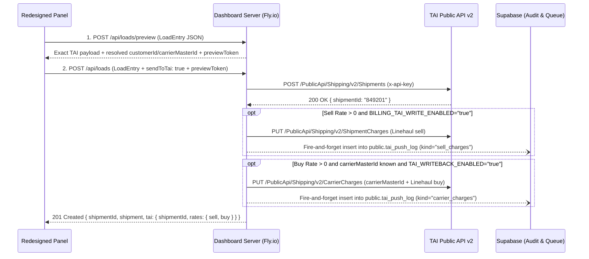

# Gmail Freight Panel Redesign — Architecture, Secrets & TAI Load Push Guide

This handoff document is designed to be dropped directly into a separate Antigravity project (for example as `PANEL_REDESIGN_SPEC.md` or referenced from `AGENTS.md`) when redesigning the **Five Nines / Primary Freight Gmail Operations Panel**.

It reflects the live production architecture on `Csturma12/primary-freight-dashboard` (`main` @ `41cfec8`), deployed on Fly.io at `https://primary-freight-dashboard.fly.dev`.

---

## 1. Current Hosting & Keyless Architecture

The panel is **100% keyless in the browser**:

- **Hosted Panel App**: Served by Express from [gmail-toolkit-static](file:///home/antigravity/Csturma12/primary-freight-dashboard/freight-dashboard/server/gmail-toolkit-static/gmail-panel.html) at `https://primary-freight-dashboard.fly.dev/gmail-toolkit/gmail-panel.html`.
- **Thin Chrome MV3 Side-Panel Shell**: Lives in `gmail-freight-toolkit/live-extension/`. It embeds the hosted `gmail-panel.html` inside a sandboxed `<iframe>` and bridges Gmail DOM thread capture, attachments, and reply-draft insertion over `window.postMessage` via [extension-shim.js](file:///home/antigravity/Csturma12/primary-freight-dashboard/freight-dashboard/server/gmail-toolkit-static/src/extension-shim.js).
- **Google Workspace Add-on Companion**: `gmail-freight-toolkit/live-extension/addon/Code.gs` provides native Gmail cards and deep-links into the hosted panel (`gmail-panel.html?view=rates`, `?view=dispatch`, etc. via [start-view.js](file:///home/antigravity/Csturma12/primary-freight-dashboard/freight-dashboard/server/gmail-toolkit-static/src/start-view.js)).
- **CI Zero-Key Enforcement**: `gmail-freight-toolkit/test/live-extension.test.mjs` fails CI if any client/extension file contains API key strings, secret env names, or direct browser calls to Gemini, OpenAI, Maps, Supabase, or TAI.

---

## 2. Complete Feature Inventory to Preserve or Redesign

### 2.1 Global Top Bar & Shell Controls
- **Home / Back Navigation (`‹ Home` & Brand Mark)**: Compact top header switching between the card-based Home launcher and active tool views without multi-row tab clutter.
- **Universal Search (`#universal-search-input`)**: Instant cross-load search by TAI Shipment ID, Customer PO, shipper reference, customer, carrier, or lane city/state.
- **Panel Zoom (`src/panel-zoom.js`)**: `−` / `100%` / `+` buttons plus `Ctrl + Plus`, `Ctrl + Minus`, and `Ctrl + 0` shortcuts that scale panel typography/density cleanly without causing horizontal overflow. Persists `pf_panel_zoom` in extension local storage.
- **Refresh & Staff Session Pill**: Manual refresh trigger (`#btn-refresh-all`), signed-in `@primarycompanies.com` staff indicator (`✓ Name`), and Google OAuth reconnect button.
- **URL Deep-Linking (`start-view.js`)**: Supports `?view=attention`, `dispatch`, `all-loads`, `rates`, `tools`, `tools-bol`, `quote-builder`, and `sales`.

### 2.2 Operations Views
1. **Attention (`attention`)**:
   - Actionable exceptions board split into 4 operational alert sections plus AP load checks, with live count badge (`#nav-attention-badge`).
2. **Dispatch Board (`dispatch`)**:
   - Live active shipments organized by operational stage (`shared/load-stages.ts`, `shared/dispatch-board.ts`).
   - Inline **Check Calls** on live loads (pickup/delivery tracking updates, notes, carrier/driver info).
   - Quick actions: **Send RateCon**, **POD Upload**, reference edits, and open in TAI / Dashboard.
3. **All Loads (`all-loads`)**:
   - Full searchable/filterable load directory (`GET /api/gmail-panel/toolkit/operations?view=...` and `GET /api/gmail-panel/loads/:reference`).
   - Load detail inspection (`GET /api/gmail-panel/loads/:reference/tracking`), reference updates, and document actions.
4. **Rates / Lane Pricing (`rates`)**:
   - Full-truckload lane pricing estimator (`POST /api/gmail-panel/quote/estimate`), powered by completed TAI shipment history (with `useDatLane: false` forced while DAT is on hold). Restricted server-side to users with `canViewFinancialDashboard`.
5. **Tools Home (`tools`) & Deck/Permit Calculator**:
   - Central card grid launching operational utilities, including the standalone [deck-permit-calculator.html](file:///home/antigravity/Csturma12/primary-freight-dashboard/freight-dashboard/server/gmail-toolkit-static/deck-permit-calculator.html) for flatbed/step-deck/oversize permit checks.
6. **Sales (`sales`)**:
   - Houston Sales Lead Board & customer/lead connections.
7. **Embedded Full Dashboard (`src/dashboard-view.js`)**:
   - Renders `https://primary-freight-dashboard.fly.dev` directly inside the panel (`Ctrl+click` opens in a new browser tab).

### 2.3 Documents Hub
1. **Load Builder (`build-load`)**:
   - **3 Intake Modes**:
     - **✨ 1. AI Extraction**: Captures the active Gmail thread + PDF/image attachments via the extension bridge (`POST /api/gmail-panel/extract`) and auto-fills a structured `LoadEntry` draft.
     - **📋 2. Copy/Paste & Manual**: Creates a manual/pasted-text draft (`POST /api/gmail-panel/manual` or `extract` with `source: "manual"`).
     - **📄 3. PDF Entry / Ready**: Uploads tender PDFs/images (`POST /api/gmail-panel/drafts/:id/file/upload` -> `transcribe` -> user confirms transcript via `confirm` -> `analyze`).
   - **Smart Stop & Facility Handling**:
     - **Single Facility Field per Stop** with a visual confirmation dot (`tai-stop-company-input.tsx` / panel stop input).
     - **Live TAI Customer & Saved-Place Autocomplete**: Pulls customer details and favorite addresses live from TAI (`server/tai-customer-details.ts`) alongside dashboard facility master records (`server/address-book.ts`).
     - **ZIP Auto-Fill & Maps Lookup**: Offline/server US ZIP lookup (`server/zip-lookup.ts`, `shared/zip-fill.ts`) + Google Maps facility address enrichment.
     - **Save to Address Book**: Writes confirmed stop facilities both to the dashboard DB and to the customer's TAI address book (`server/tai-address-book-save.ts`).
   - **Continuous Memory & Learning Hub (`#learn` / `0 Learned` badge)**:
     - **Save & Learn (`#save`)**: Saves draft edits (`POST /api/gmail-panel/save`) and proposes/approves reusable customer, lane, and facility rules in production Supabase (`POST /api/gmail-panel/knowledge/{retrieve,propose,decide}`).
   - **Saved Drafts (`#history`) & Preview/PDF (`#preview`)**: Reopen in-progress drafts (`GET /api/gmail-panel/drafts`), generate summary/PDF sheets, or insert a formatted reply into Gmail.
   - **🚀 One-Click "Generate Load in TAI" (`#handoff`)**:
     - Locks the reviewed draft, runs TAI readiness + enum + customer/carrier mapping + duplicate-booking checks, creates the shipment in TAI, assigns the returned TAI `shipmentId`, and pushes customer sell + carrier buy charges.
2. **BOL Generator (`tools-bol`)**:
   - Hydrates Bill of Lading fields from any load (`GET /api/gmail-panel/loads/:reference/bol`, `shared/bol.ts`) or manual input for clean PDF printing.
3. **Formal Quote Builder (`quote-builder`)**:
   - Builds customer-facing rate quotes with lane details, accessorials, and one-click Gmail reply insertion.
4. **RateCon Send & POD Upload**:
   - **Send RateCon**: Generates carrier rate confirmations (`shared/ratecon-document.ts`) and emails/downloads them (`server/ratecon-send-routes.ts`).
   - **POD Upload**: Uploads Proof of Delivery PDFs/images (`POST /api/gmail-panel/loads/:id/pod`) and marks verified **only** after TAI `GET /Shipments/{id}` read-back confirms the attachment exists.

### 2.4 Current Email & AI Bar
- **✨ Check Against Loads (`check-email`)**: Scans the open Gmail thread against active loads to surface matching shipments, status discrepancies, or explicit tender cancellations (`server/gmail-panel/cancellation.ts`).
- **🤖 AI Assistant (`ai-assistant`)**: Natural-language freight operations Q&A (load coverage, customer lane history, carrier setup status in TAI).
- **📨 AP Emails (`ap-tasks`)**: Freight Accounts Payable email collector, filter query, and task configurator (`/api/gmail-panel/ap/*`).

---

## 3. How Keys & Secrets Work (Git Repo vs. GitHub Actions vs. Fly.io)

> [!CAUTION]
> **Raw secret values are NEVER stored in the git repository.**
> - Never commit API keys to git, client bundles, or `chrome.storage`.
> - Never read, edit, or commit `.env`, `local-data/`, or `data.db` (all gitignored local state).
> - Never set or reuse real key names like `TAI_API_KEY` inside tests, probes, or self-tests — doing that previously wiped the live `TAI_API_KEY` twice. Always pass fixture strings via options (`{ credential: "fixture-key" }`).
> - Never rotate `TAI_API_KEY` or the TAI webhook secret.

### 3.1 Where Keys Actually Live (3 Layers)

Because raw values are not in git, credentials are split across three places depending on their job:

| Layer | Where It Lives | How to Inspect Names (No Values) | What Lives Here |
| :--- | :--- | :--- | :--- |
| **1. Checked-in Non-Secret Config** | [fly.toml](file:///home/antigravity/Csturma12/primary-freight-dashboard/freight-dashboard/fly.toml#L47-L50) `[env]` in git | Read `freight-dashboard/fly.toml` | `TAI_WRITEBACK_ENABLED = "true"`<br>`BILLING_TAI_WRITE_ENABLED = "true"`<br>`GMAIL_FREIGHT_TOOLKIT_OAUTH_CLIENT_IDS = "..."` |
| **2. CI / Deploy Secrets** | GitHub Repo -> `Settings -> Secrets and variables -> Actions` ([fly-deploy.yml](file:///home/antigravity/Csturma12/primary-freight-dashboard/.github/workflows/fly-deploy.yml)) | `gh secret list -R Csturma12/primary-freight-dashboard` | `FLY_API_TOKEN`, `FLY_SSH_TOKEN`, `TAI_API_KEY`, `TAI_SUPABASE_RELAY_KEY`, `AI_ASSISTANT_RELAY_SECRET`, `ANTHROPIC_API_KEY`, `DAT_SVC_USERNAME`, `EIA_API_KEY`, `FRED_API_KEY` (plus optional `TAI_SUPABASE_RELAY_SECRET`, `VITE_SENTRY_DSN`) |
| **3. Production Runtime Secrets (Source of Truth)** | **Fly.io Secrets** on app `primary-freight-dashboard` (`dfw`), injected as `process.env.*` in Node | Verified automatically on every deploy in `fly-deploy.yml` step `Report configured secret names (no values)` via `flyctl secrets list --json` | `TAI_API_KEY`, `SUPABASE_URL`, `SUPABASE_SERVICE_ROLE_KEY`, `GEMINI_API_KEY`, `OPENAI_API_KEY`, `GOOGLE_MAPS_API_KEY`, `GOOGLE_CLIENT_ID`, `GOOGLE_CLIENT_SECRET`, `SESSION_SECRET`, `OPS_GATEWAY_TOKEN`, `PERPLEXITY_API_KEY`, `CLAY_API_KEY`, `V0_API_KEY`, `GMAIL_CROSSCHECK_SECRET` |

> [!NOTE]
> **Why you cannot `git grep` or `gh secret` raw secret values out of GitHub**: Both GitHub Actions Secrets and Fly.io Secrets are **write-only encrypted stores**. Neither `gh` nor `flyctl secrets list` returns plaintext values — they only expose secret **names** to humans/logs and inject values directly into the container's `process.env` at runtime.

### 3.2 Key Server `process.env` Variables Used by the Dashboard

| Variable Name | Purpose in `freight-dashboard/server/` |
| :--- | :--- |
| `TAI_API_KEY` | Primary TAI Public API v2 broker key (`x-api-key` header). Read dynamically via [`taiApiKey()`](file:///home/antigravity/Csturma12/primary-freight-dashboard/freight-dashboard/server/tai-client.ts#L34-L36), which strips accidental surrounding quotes/whitespace. |
| `TAI_BASE_URL` | Optional override; defaults to `https://primaryfreightllc.taicloud.net`. |
| `TAI_WRITEBACK_ENABLED` | Set to `"true"` in `fly.toml`. Enables carrier/buy charges, reference numbers, and tracking write-backs (`server/tai-writeback.ts`). |
| `BILLING_TAI_WRITE_ENABLED` | Set to `"true"` in `fly.toml`. Enables customer sell-rate linehaul pushes (`server/billing/tai-charges.ts`). |
| `TAI_ADDRESS_BOOK_SAVE_ENABLED` | Gate for `PUT /PublicApi/Customer/v2/Addresses` (`server/tai-address-book-save.ts`); off by default until TAI tenant 500 behavior is cleared. |
| `SUPABASE_URL` | Production Supabase URL (`https://nonqwidfqrklksjluloz.supabase.co` — never connect to legacy `PFIHDASHBOARD`). |
| `SUPABASE_SERVICE_ROLE_KEY` | Required server-only key for `pm_*` tables, `tai_carrier_assignments` queue, `tai_push_log`, shipment recovery, and shared toolkit knowledge. |
| `GEMINI_API_KEY` | Used by Gmail Freight Toolkit draft analysis & attachment transcription (`server/gmail-freight-toolkit/gemini.ts`, Free-tier Gemini project). |
| `OPENAI_API_KEY` | Used by structured file/email extraction paths (`server/gmail-panel/openai-extraction.ts`). |
| `GOOGLE_MAPS_API_KEY` | Server-side facility address & stop lookup enrichment. |
| `GOOGLE_CLIENT_ID` / `GOOGLE_CLIENT_SECRET` / `SESSION_SECRET` | Google Workspace (`@primarycompanies.com`) staff login & Express session cookies. |
| `OPS_GATEWAY_TOKEN` | (>= 32 chars) Shared server-to-server token allowing an external Five Nines Ops / redesigned panel backend to call `/api/*` on behalf of a signed-in staff user ([ops-gateway-auth.ts](file:///home/antigravity/Csturma12/primary-freight-dashboard/freight-dashboard/server/ops-gateway-auth.ts)). |

### 3.3 How Your Redesigned Panel Should Authenticate & Use Keys

Depending on where your redesigned panel lives, use **one of these two keyless patterns** so you never duplicate `TAI_API_KEY` or AI keys into browser code (or across multiple repos):

#### Option 1: Hosted Directly on `primary-freight-dashboard` (Same-Origin Browser Session)
1. Staff signs in via `/auth/google` (`@primarycompanies.com` Google Workspace).
2. Panel calls `GET /api/gmail-panel/session` with `credentials: "include"` and receives `{ user: { id, email, displayName }, csrfToken }`.
3. Every subsequent `/api/gmail-panel/*` call sends:
   - `credentials: "include"` (session cookie)
   - `x-csrf-token: <csrfToken>` (on mutating `POST`/`PUT`/`PATCH`/`DELETE` requests)
   - `x-gmail-panel-expected-email: <user.email>` (prevents cross-account tab drift; returns `409 toolkit_account_changed` on mismatch)

#### Option 2: Separate Redesign Repo / Next.js Backend Calling Dashboard via Ops Gateway (Recommended for Standalone Projects)
If your panel redesign runs in its own project (like `fivenineslogistics` / `fivenines-ops`), **do not copy `TAI_API_KEY` or `SUPABASE_SERVICE_ROLE_KEY` into the new repo**. Instead, proxy through [ops-gateway-auth.ts](file:///home/antigravity/Csturma12/primary-freight-dashboard/freight-dashboard/server/ops-gateway-auth.ts):
1. Sign staff into your redesigned app with Google Workspace (`@primarycompanies.com`).
2. Store **one** shared secret (`OPS_GATEWAY_TOKEN`, at least 32 characters) on both your new app's server and `primary-freight-dashboard`.
3. From your new app's server routes, forward requests to `https://primary-freight-dashboard.fly.dev/api/...` with these headers:
   ```http
   x-ops-gateway-token: <OPS_GATEWAY_TOKEN>
   x-ops-acting-user: chriss@primarycompanies.com
   x-ops-acting-name: Chris%20Sturma
   ```
4. `primary-freight-dashboard` verifies the SHA-256 digest in constant time, enforces the exact staff/financial permissions of `x-ops-acting-user`, and executes the TAI / Supabase / AI call using its own Fly secrets. *(Blocked paths on the gateway for safety: `/api/auth/*`, `/api/portal/*`, `/api/webhooks/*`, `/api/outlook/auth-*`.)*

---

## 4. How to Use `TAI_API_KEY` to Push Loads & Rates into TAI

### 4.1 Critical Architectural Rule: Create First, Push Dollars Second

TAI's `POST /PublicApi/Shipping/v2/Shipments` (`CommitDomesticShipmentRequest`) **has no buy-rate or sell-rate fields** (sending nested `customer`, `carrierList`, `totalBuy`, or `totalSell` causes TAI's .NET model binder to silently drop them). Pushing a complete load into TAI is therefore a **3-step sequence**:



---

### 4.2 Path A (Recommended): Pushing Loads via the Dashboard API

Always prefer calling the dashboard's guarded booking routes rather than hitting TAI raw, because the dashboard automatically resolves `customerOrganizationId` and `carrierMasterId` from master records, validates TAI enums, blocks accidental duplicate bookings, saves the local shipment row so inbound TAI webhooks match it, pushes sell/buy rates, and writes redacted audit rows to `tai_push_log`.

#### Endpoint Set 1: Direct Load Builder Routes ([load-entry-routes.ts](file:///home/antigravity/Csturma12/primary-freight-dashboard/freight-dashboard/server/load-entry-routes.ts))
- `GET /api/tai/booking/status` -> `{ configured: boolean, enabled: boolean, baseUrl: string }`
- `POST /api/loads/preview` -> Validates `LoadEntry`, resolves customer `taiOrganizationId` and carrier `carrierMasterId`, and returns `{ url, body, context, previewToken }` **without** calling TAI.
- `POST /api/loads` -> Sends `{ ...loadEntry, sendToTai: true, previewToken }` to create the shipment in TAI, push sell/buy charges, and persist the shipment locally.
  - **Duplicate Guard (`409`)**: If an identical load was already booked for that customer (matching PO / reference / lane-date), returns `409` with `{ duplicateOf, matchedOn, requiresDuplicateConfirmation: true }`. Re-POST with `confirmDuplicate: true` only after explicit user confirmation.

#### Endpoint Set 2: Draft-Tracked Gmail Toolkit Routes ([toolkit/routes.ts](file:///home/antigravity/Csturma12/primary-freight-dashboard/freight-dashboard/server/toolkit/routes.ts))
When booking from an AI-extracted Gmail draft (`draftId` tracked in intake storage):
1. `POST /api/gmail-panel/toolkit/preview`
   ```json
   {
     "draftId": "550e8400-e29b-41d4-a716-446655440000",
     "version": 2,
     "mutationId": "7c9e6679-7425-40de-944b-e07fc1f90ae7",
     "entry": { "...LoadEntry fields..." }
   }
   ```
   Returns `{ previewToken, body, context, ... }`.
2. `POST /api/gmail-panel/toolkit/create`
   ```json
   {
     "draftId": "550e8400-e29b-41d4-a716-446655440000",
     "version": 2,
     "mutationId": "8f14e45fceea-11e7-8941-0050569c6d45",
     "previewToken": "<64-char sha256 hex from preview>",
     "confirmed": true,
     "entry": { "...LoadEntry fields...", "sendToTai": true, "status": "Committed" }
   }
   ```
   Locks the reviewed draft via `intakeLoadGuard` so retries or double-clicks can never create two TAI shipments from one email.

#### Minimal Valid `LoadEntry` Input Shape ([shared/load-entry.ts](file:///home/antigravity/Csturma12/primary-freight-dashboard/freight-dashboard/shared/load-entry.ts))
```json
{
  "shipmentId": "",
  "status": "Committed",
  "shipmentType": "Truckload",
  "sendToTai": true,
  "customer": {
    "name": "Acme Metals Inc",
    "taiOrganizationId": "10482",
    "contactName": "Jane Doe",
    "phone": "713-555-0199",
    "email": "shipping@acmemetals.com"
  },
  "references": {
    "customerPO": "PO-99412",
    "shipperReference": "REL-441",
    "pickupNumber": "PU-8821",
    "custom": []
  },
  "stops": [
    {
      "stopType": "First Pickup",
      "companyName": "Acme Houston Mill",
      "streetAddress": "1200 Industrial Pkwy",
      "city": "HOUSTON",
      "state": "TX",
      "zipCode": "77015",
      "country": "USA",
      "readyDateTime": "2026-11-20T08:00",
      "closeDateTime": "2026-11-20T15:00"
    },
    {
      "stopType": "Last Drop",
      "companyName": "Midwest Fab Plant",
      "streetAddress": "4500 Commerce Rd",
      "city": "TULSA",
      "state": "OK",
      "zipCode": "74107",
      "country": "USA",
      "appointmentDateTime": "2026-11-21T09:00",
      "appointmentEndDateTime": "2026-11-21T11:00"
    }
  ],
  "items": [
    {
      "description": "Steel Coils",
      "packagingType": "Truckload",
      "handlingQuantity": 2,
      "piecesTotal": 2,
      "weightTotal": 42000,
      "hazardousMaterial": false,
      "freightClass": "No Class"
    }
  ],
  "accessorials": [
    { "scope": "pickup", "code": "TARP", "name": "Tarp Fee", "sell": 150, "buy": 100 }
  ],
  "equipment": {
    "trailerSize": "Full",
    "trailerType": "48 ft Flatbed",
    "stackable": false,
    "mileage": 510
  },
  "carrier": {
    "name": "Lone Star Flatbed LLC",
    "taiCarrierMasterId": "58291",
    "scac": "LSFB",
    "serviceLevel": "Normal",
    "buy": 1650,
    "sell": 2050,
    "fuelBuy": 0,
    "fuelSell": 0
  }
}
```
*(Note: If a stop only has `readyDate: "2026-11-20"` and no time, `fillDateOnlyStopTimes` fills `08:00` for pickups and `15:00` for drops unless an explicit extracted date/time mismatch requires user input.)*

---

### 4.3 Path B (Under the Hood): Direct Server-Side `TAI_API_KEY` HTTP Contracts

If you are modifying server-side TAI code in `freight-dashboard/server/`, every TAI request uses:
- **Base URL**: `https://primaryfreightllc.taicloud.net` (`process.env.TAI_BASE_URL` override supported)
- **Headers**:
  ```http
  x-api-key: <taiApiKey()>
  Content-Type: application/json
  Accept: application/json
  ```
- **Key Hygiene**: Always read the key through `taiApiKey()` in [tai-client.ts](file:///home/antigravity/Csturma12/primary-freight-dashboard/freight-dashboard/server/tai-client.ts#L34-L36) so pasted quotes or trailing newlines are stripped (TAI returns a bare `401` if whitespace is present).

#### 1. Create Domestic Shipment (`POST /PublicApi/Shipping/v2/Shipments`)
Implemented in [`bookTaiShipment`](file:///home/antigravity/Csturma12/primary-freight-dashboard/freight-dashboard/server/tai-booking.ts) + [`buildTaiShipmentRequest`](file:///home/antigravity/Csturma12/primary-freight-dashboard/freight-dashboard/shared/load-entry.ts#L597-L671) (30-second timeout):
```json
{
  "shipmentType": "Truckload",
  "isCommitted": true,
  "rateShipment": false,
  "customerId": 10482,
  "carrierSCAC": "LSFB",
  "serviceLevel": "Normal",
  "trailerSize": "Full",
  "trailerType": "48 ft Flatbed",
  "weightUnits": "lbs",
  "dimensionUnits": "in",
  "stackable": false,
  "mileage": 510,
  "driverCellPhoneNumber": null,
  "stops": [
    {
      "stopType": "First Pickup",
      "companyName": "Acme Houston Mill",
      "streetAddress": "1200 Industrial Pkwy",
      "streetAddressTwo": null,
      "city": "HOUSTON",
      "state": "TX",
      "zipCode": "77015",
      "country": "USA",
      "contactName": null,
      "phone": null,
      "email": null,
      "instructions": "",
      "notes": null,
      "referenceNumber": null,
      "estimatedReadyDateTime": "2026-11-20T08:00:00",
      "estimatedCloseDateTime": "2026-11-20T15:00:00",
      "appointmentReadyDateTime": null,
      "appointmentCloseDateTime": null,
      "shipmentStopReferenceNumbers": []
    },
    {
      "stopType": "Last Drop",
      "companyName": "Midwest Fab Plant",
      "streetAddress": "4500 Commerce Rd",
      "streetAddressTwo": null,
      "city": "TULSA",
      "state": "OK",
      "zipCode": "74107",
      "country": "USA",
      "contactName": null,
      "phone": null,
      "email": null,
      "instructions": "",
      "notes": null,
      "referenceNumber": null,
      "estimatedReadyDateTime": null,
      "estimatedCloseDateTime": null,
      "appointmentReadyDateTime": "2026-11-21T09:00:00",
      "appointmentCloseDateTime": "2026-11-21T11:00:00",
      "shipmentStopReferenceNumbers": []
    }
  ],
  "commodities": [
    {
      "description": "Steel Coils",
      "piecesTotal": 2,
      "weightTotal": 42000,
      "freightClass": "No Class",
      "packagingType": "Truckload",
      "handlingQuantity": 2,
      "hazardousMaterial": false,
      "hazardClasses": [],
      "nmfc": null,
      "length": null,
      "width": null,
      "height": null,
      "referenceNumber": null,
      "shipmentCommodityReferenceNumbers": []
    }
  ],
  "shipmentReferenceNumbers": [
    { "referenceType": "Customer PO Number", "value": "PO-99412" },
    { "referenceType": "Shipper Reference Number", "value": "REL-441" },
    { "referenceType": "Linehaul Pickup Number", "value": "PU-8821" }
  ],
  "accessorialCodes": [
    { "code": "TARP", "name": "Tarp Fee - Pickup" }
  ],
  "tariffs": [
    {
      "tariffName": "Linehaul",
      "transitLeg": "Linehaul",
      "serviceLevel": "Normal",
      "carrierSCAC": "LSFB"
    }
  ]
}
```
- **Stop Types**: First stop must be `"First Pickup"`, intermediate stops `"Pick"` or `"Drop"`, final stop `"Last Drop"`.
- **Datetimes**: Must be stop-local `"YYYY-MM-DDTHH:mm:00"` with **no `Z` or UTC offset**.
- **Response Parsing**: Parse the assigned ID with [`extractTaiShipmentId`](file:///home/antigravity/Csturma12/primary-freight-dashboard/freight-dashboard/shared/load-entry.ts#L679-L706) (handles `{ shipmentId }`, `{ ShipmentId }`, `{ id }`, `{ data: { shipmentId } }`, or a bare integer body).

#### 2. Push Customer Sell Rate (`PUT /PublicApi/Shipping/v2/ShipmentCharges`)
Implemented in [tai-charge-request.ts](file:///home/antigravity/Csturma12/primary-freight-dashboard/freight-dashboard/server/billing/tai-charge-request.ts) & [tai-charges.ts](file:///home/antigravity/Csturma12/primary-freight-dashboard/freight-dashboard/server/billing/tai-charges.ts):
```json
{
  "referenceNumbers": [
    { "referenceType": "Shipment Id", "value": "849201" }
  ],
  "transitType": "Linehaul",
  "charges": [
    { "chargeType": "Linehaul", "price": 2200, "calculationType": "Flat" }
  ]
}
```
- **Important**: `referenceType` must be spelled `"Shipment Id"` (with a space and lowercase `d`), never `"ShipmentId"`.

#### 3. Push Carrier Assignment & Buy Rate (`PUT /PublicApi/Shipping/v2/CarrierCharges`)
Implemented in [`pushCarrierCharges`](file:///home/antigravity/Csturma12/primary-freight-dashboard/freight-dashboard/server/tai-writeback.ts#L129-L150):
```json
{
  "referenceNumbers": [
    { "referenceType": "Shipment Id", "value": "849201" }
  ],
  "transitType": "Linehaul",
  "charges": [
    { "chargeType": "Linehaul", "price": 1750, "calculationType": "Flat" }
  ],
  "carrierMasterId": 58291
}
```
- **Carrier Identity Requirement**: `carrierMasterId` is an integer assigned by TAI (learned from webhooks or prior TAI carrier sync). If `carrierMasterId` is unknown/blank, this endpoint cannot be called cold.
- **Edits to Existing Loads**: On existing shipments, carrier/buy edits go through the durable Supabase `tai_carrier_assignments` queue consumed **exclusively** by the Fly worker in `server/tai-writeback-poller.ts` (never add a second cron or Edge Function consumer), which verifies every write via `GET /PublicApi/Shipping/v2/Shipments/{shipmentId}` read-back before updating local state.

#### 4. Additional TAI Write Endpoints Available on the Server
- **Update Reference Numbers**: `PUT /PublicApi/Shipping/v2/ShipmentReferenceNumbers?shipmentId={numericId}` — shipment ID is in the **query string**, and the body is a bare JSON array `[{ "referenceType": "Customer PO Number", "value": "..." }]`.
- **Update Planning Dates / Status**: `PUT /PublicApi/Shipping/v2/Tracking` — `{ "shipmentId": 849201, "transitType": "Linehaul", "trackingUpdate": { "pickupReadyDateTime": "...", "deliveryEstimatedDateTime": "...", "shipmentStatus": "Dispatched" } }` *(Note: TAI spells `"Canceled"` with one `l`)*.
- **Connection Self-Check**: `GET /PublicApi/Broker/v2/ShipmentReferenceTypes` (`checkTaiConnection` in `server/tai-client.ts`).

#### 5. Mandatory Safety & Retry Rules for TAI Writes
1. **Never Auto-Retry Timeouts or Ambiguous Responses**: If `POST /Shipments`, `PUT /ShipmentCharges`, `PUT /CarrierCharges`, or POD upload times out or returns `200` without a recognizable ID/read-back match, **stop and mark for human reconciliation**. Retrying blindly creates duplicate shipments or duplicate charges in TAI.
2. **Stop Immediately on `401` / `403`**: Repeated authentication failures lock out the TAI account. Any poller or batch job must halt immediately on `401`/`403`.
3. **Audit Every Direct Push**: Every direct `PUT` to TAI calls `void recordTaiPush(...)` ([tai-push-log.ts](file:///home/antigravity/Csturma12/primary-freight-dashboard/freight-dashboard/server/tai-push-log.ts)) to record an append-only, secret-redacted row in Supabase `public.tai_push_log`.

---

## 5. Chrome Extension Bridge Contract to Preserve

If your redesigned panel will be loaded inside the existing MV3 Chrome extension (`gmail-freight-toolkit/live-extension/panel-frame.js`), keep compatibility with the `window.parent.postMessage` bridge implemented in [extension-shim.js](file:///home/antigravity/Csturma12/primary-freight-dashboard/freight-dashboard/server/gmail-toolkit-static/src/extension-shim.js):

- **Gmail Thread & Attachment Capture**: Request active Gmail message subject, sender, timestamps, body, permalink, and base64 PDF/image attachments from the content script via the parent extension frame (`captureThread` / `captureAttachments`).
- **Gmail Reply / Compose Insertion**: Send formatted quote/ratecon/summary text or HTML back to the parent frame to insert into Gmail's open reply box.
- **Allowed `chrome.storage.local` Keys (Preferences Only — Never Secrets or Drafts)**:
  - `pf_panel_zoom`
  - `pf_ap_FilterQuery`
  - `pf_ap_TaskConfig`

### Targeted Verification Commands (in `primary-freight-dashboard`)
```bash
# 1. Verify zero client keys & extension shim contract
node --test gmail-freight-toolkit/test/live-extension.test.mjs

# 2. Typecheck dashboard + panel routes (run from freight-dashboard/)
npm --prefix freight-dashboard run check
```
